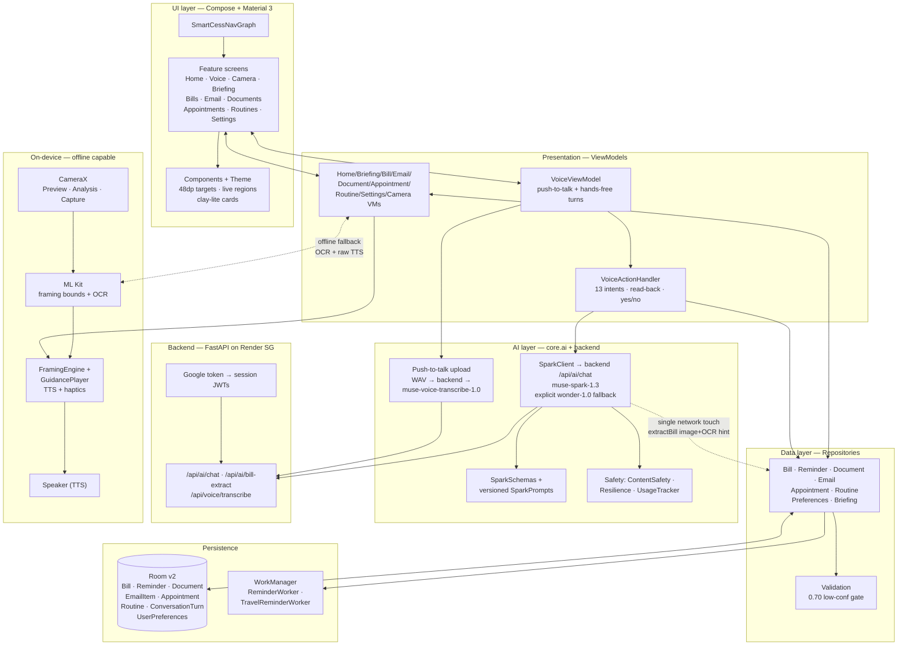

# SmartCess Architecture

MVVM + Repository, single-activity Jetpack Compose (Material 3, single white
theme) app with Hilt dependency injection. Package: `com.smartcess.app`.
Min SDK 26, target/compile 34.

Mantra: **Transcribe listens, Spark thinks, ML Kit guides, the app acts safely.**

## Architecture diagram

## Layer responsibilities

- **UI (`ui/`, `features/`, `navigation/`)** — dumb composables + TalkBack-first
  components; all user text in `strings.xml`; confirmation dialogs gate every
  committing action. Home uses progressive disclosure (Talk, Today card,
  Scan Bill button, More sheet, Settings).
- **Presentation** — one ViewModel per screen; exposes `StateFlow` UI state;
  speaks via `Speaker`; never touches Room or Retrofit directly. `VoiceViewModel`
  owns recording/upload/playback; `VoiceActionHandler` owns intent execution
  with read-back and explicit yes/no confirmation.
- **Data (`data/repository/`)** — validation rules, briefing aggregation
  (`BriefingRepository.getTodayData()`); returns `SaveOutcome(id, validation)`
  so low-confidence saves surface review UI.
- **AI (`core/ai/` + backend)** — `SparkClient` (cache-first,
  invalid-JSON retry-once-then-safe-default, explicit primary→fallback models),
  versioned prompts, JSON schemas, rate limiting, retries, usage logging.
  All Meta traffic goes through the authenticated backend proxy; the app never
  holds the Meta key in distributed builds.
- **On-device (`core/voice`, `core/media`, `features/camera/`)** — push-to-talk
  recording with auto-stop, image compression, pure JVM-testable `FramingEngine`
  with priority no-text > far/close > edge+direction > off-center > tilt >
  lighting, and speak-once-per-direction guidance with hysteresis.
- **Persistence (`data/local/`, `core/work/`, `core/privacy/`)** — Room v2
  (schema export on, reviewed migrations), WorkManager unique-work reminders,
  typed JSON/CSV export + full delete, opt-in analytics (metadata only).

## Key flows

**Guided bill scan (core loop):**
CameraX frames → ML Kit text bounds (sampled frames) → `FramingEngine` →
`GuidancePlayer` speaks one instruction per direction (haptic tick) → READY
→ tap or voice capture → compress → bill extraction over the single network
touch → `validateBill` → spoken + shown review (save / retake / delete) →
user-confirmed save to the correct repository (bill vs document mode is
explicit end to end).

**Talk turn:**
Talk tap → record with auto-stop → HTTPS upload → backend transcribes
(`muse-voice-transcribe-1.0`) → Spark classifies intent / extracts slots →
`VoiceActionHandler` asks for missing details, reads back the exact action,
waits for spoken yes/no → saves through the same repository path as the manual
screen → speaks success only after persistence. "No"/"cancel" saves nothing;
the mic reopens hands-free after a 400 ms TTS tail guard.

**Daily briefing:** `BriefingRepository.getTodayData()` aggregates overdue bills,
due<7d, appointments today/tomorrow, and routines due → spoken inside Talk or
shown on Home; AI failure is announced as unavailable, never as "all clear".

**Prepare–confirm–act (safety):** every committing action (save, schedule,
calendar, archive, delete) asks through a confirmation dialog or spoken
confirmation first. Banned actions — pay, send email, submit forms, navigate,
call — have no code path at all.

## Android → backend → Meta request path

The app layer never contacts Meta. Retrofit interfaces (`BackendChatApi`,
`BackendVoiceApi`, `BackendAuthApi`) send session-JWT-authenticated HTTPS to
exactly two AI routes: `POST api/ai/chat` (all Spark work — intents, slot
extraction, bill extraction, summaries, Q&A) and `POST api/voice/transcribe`
(WAV upload). The FastAPI backend validates the JWT, enforces the model
allowlist, attaches the server-side Meta key, and forwards to
`https://api.meta.ai/v1/chat/completions` and `/v1/asr/transcribe`. Responses
return parsed JSON or transcript text; failures map to typed errors
(`SessionExpired`, `RateLimited`, `Timeout`, …) that the app speaks. Every hop
is logged server-side with a request ID (see README "Meta AI Integration &
Verification"). The backend's separate `/api/ai/bill-extract` route exists but
the app does not call it — extraction goes through the chat route.

## Configuration

API key resolution: hidden developer Settings screen entry (debug only) →
`BuildConfig.META_API_KEY` (process env → `local.properties` → root `.env`,
first non-blank wins) → absent. Test and release builds set
`KEYLESS_DEBUG=true`, forcing the baked key empty: the production transport
never needs it (backend/session path). No hard-coded keys anywhere.
Backend URL resolves the same way (`BACKEND_URL`), defaulting to
`https://smartcess-backend.onrender.com/`; production runs in Singapore
(`https://smartcess-sg.onrender.com`). With no network, every AI entry degrades
to labelled offline drafts/banners; on-device framing, OCR, and TTS keep working.

## Decisions & trade-offs

- Push-to-talk HTTPS upload instead of a realtime socket: reliable on mobile
  networks and simple to secure; live interim transcription is deferred (the
  backend keeps a dormant relay for that milestone).
- ML Kit GMS (not bundled) for OCR: smaller APK, needs Play Services +
  first-run model download; failure degrades to manual capture with a spoken hint.
- Routines are daily-only in both manual and voice paths: weekly/monthly
  requests are refused with an explanation rather than mis-scheduled.
- Email is a saved on-device inbox with no provider connected yet: the retired
  demo seeds are purged on sight and the section stays dormant until Gmail.
- SAM 3.1 + Muse Image exist only as off-by-default feature flags (post-MVP).
- Room schema export enabled (`app/schemas/`) for reviewed migrations.
