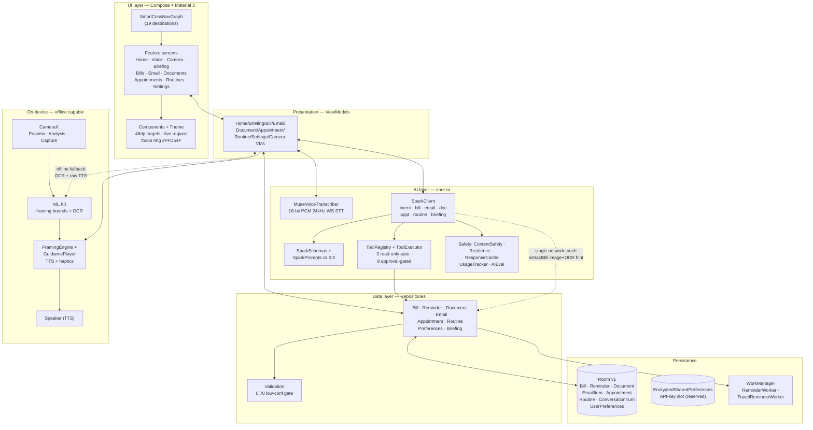

# SmartCess Architecture

MVVM + Repository, single-activity Jetpack Compose (Material 3) app with Hilt
dependency injection. Package: `com.smartcess.app`. Min SDK 26, target/compile 34.

Mantra: **Transcribe listens, Spark thinks, ML Kit guides, the app acts safely.**

## Architecture diagram

## Layer responsibilities

- **UI (`ui/`, `features/`, `navigation/`)** — dumb composables + TalkBack-first
  components; all user text in `strings.xml`; confirmation dialogs gate every
  committing action. Home uses progressive disclosure (Talk, one Today card,
  one Scan Bill button, More sheet, Settings).
- **Presentation** — one ViewModel per screen; exposes `StateFlow` UI state;
  speaks via `Speaker`; never touches Room or Retrofit directly.
- **Data (`data/repository/`)** — validation rules (`Validation.kt`), briefing
  aggregation (`BriefingRepository.getTodayData()`), demo inbox seeding;
  returns `SaveOutcome(id, validation)` so low-confidence saves surface review UI.
- **AI (`core/ai/`)** — `SparkClient` (cache-first, invalid-JSON retry-once-then-safe-default,
  primary→fallback models, 2-round tool loop), versioned prompts, JSON schemas,
  approval-gated tool execution, rate limiting, retries, usage/eval logging.
- **On-device (`core/voice`, `core/media`, `features/camera/`)** — STT streaming,
  image compression (<1MB), pure JVM-testable `FramingEngine` with priority
  no-text > far/close > off-center > tilt > lighting.
- **Persistence (`data/local/`, `core/work/`, `core/privacy/`)** — Room v1
  (schema export on), WorkManager unique-work reminders surviving reboot,
  typed JSON export + full delete, opt-in analytics (metadata only).

## Key flows

**Guided bill scan (core loop):**
CameraX frames → ML Kit text bounds (every 3rd frame) → `FramingEngine` →
`GuidancePlayer` speaks one instruction (3s cooldown, haptic tick) → READY
(long pulse) → capture → compress → `SparkClient.extractBill` (the single
network touch) → `validateBill` → review screen → user-confirmed save.

**Daily briefing:** `BriefingRepository.getTodayData()` aggregates overdue bills,
due<7d, appointments today/tomorrow, urgent email, doc deadlines, routines due →
Spark composes spoken summary → `Speaker` reads it; offline falls back to cached
data with the offline label.

**Prepare–confirm–act (safety):** every committing action (save, schedule,
calendar, archive, delete) asks through a confirmation dialog first. The tool
definitions in `ToolRegistry` are tested data for the agent roadmap; no
tool-calling loop is wired yet, so nothing executes tools automatically.
Banned actions — pay, send email, submit forms, navigate, call — have no code
path at all.

## Configuration

API key resolution order: EncryptedSharedPreferences entry (no in-app UI
writes it today; reserved) → `BuildConfig.META_API_KEY` (process env →
`local.properties` → root `.env`, first non-blank wins) → absent (offline
mode). No hard-coded keys. Debug builds take the key from the local
environment; release builds force the key empty and run offline-capable.
Endpoints default to the official Meta Model API URLs
(`https://api.meta.ai/v1/`, `wss://api.meta.ai/v1/asr/realtime`), overridable
via env. With no key or network, every AI entry degrades to labelled offline
drafts/banners; on-device framing, OCR, and TTS keep working.

## Decisions & trade-offs

- ML Kit GMS (not bundled) for OCR: smaller APK, needs Play Services +
  first-run model download; failure degrades to manual capture.
- Email MVP uses a seeded local demo inbox; Gmail/Outlook is roadmap.
- SAM 3.1 + Muse Image exist only as off-by-default feature flags (post-MVP).
- Room schema export enabled (`app/schemas/`) for reviewed migrations.
